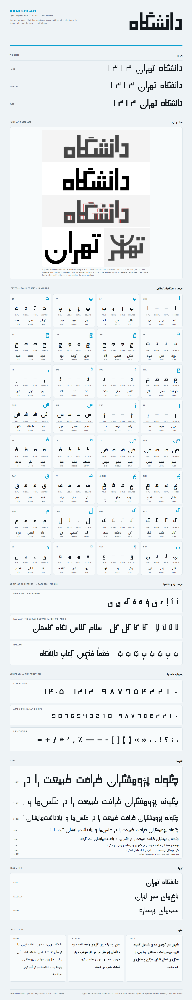
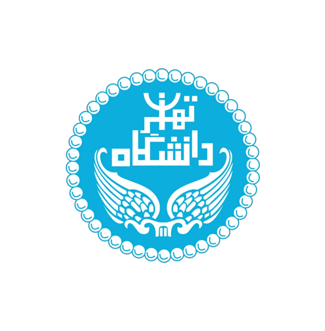
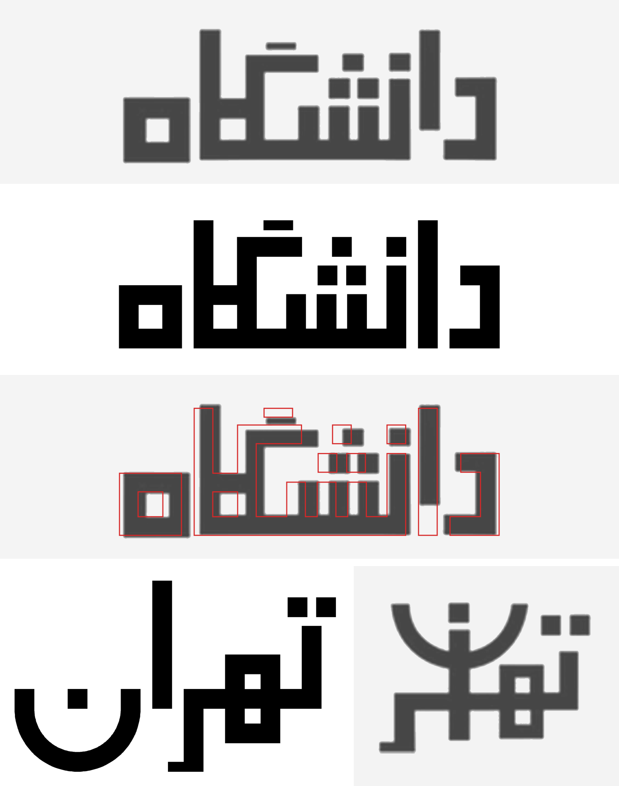

<div dir="rtl">

# دانشگاه · Daneshgah

دانشگاه یک فونت فارسی تیتر به سبک کوفی مربعی است، در سه وزن. این فونت از روی نوشته‌ی «دانشگاه» در آرم قدیمی دانشگاه تهران ساخته شده است. خط‌ها همه یک ضخامت دارند، حروف روی یک کرسی صاف به هم وصل می‌شوند، و دندانه‌ها و نقطه‌ها مربعی‌اند.

این فونت رایگان و متن‌باز است و با [مجوز MIT](LICENSE) منتشر شده است.



[نمونه‌ی حروف](Daneshgah-specimen.html) را در مرورگر هم می‌توانید باز کنید.

## آرم اصلی



در تصویر زیر، بالا نوشته‌ی «دانشگاه» در آرم است، بعد فونت دانشگاه Bold در همان اندازه، و بعد خط دور فونت روی خود آرم. در ردیف آخر، «تهران» آرم (سمت راست) کنار «تهران» فونت (سمت چپ) آمده است، با همان اندازه و روی همان کرسی. حروف «تهران» در آرم روی هم چیده شده‌اند؛ برای همین این دو را روی هم نگذاشته‌ایم.



## وزن‌ها

| وزن | نام در برنامه‌ها |
| --- | --- |
| Light (300) | Daneshgah Light |
| Regular (400) | Daneshgah |
| Bold (700) | Daneshgah Bold، هم‌وزن آرم |

در Word و برنامه‌های مشابه، Daneshgah را انتخاب کنید. با Ctrl+B بین Regular و Bold جابه‌جا می‌شوید. نام فارسی فونت در برنامه‌ها «دانشگاه» است.

## نصب

در پوشه‌ی `fonts` سه نوع فایل هست:

| فایل | کاربرد |
| --- | --- |
| `.ttf` | نصب روی ویندوز، مک و لینوکس |
| `.otf` | برنامه‌های طراحی |
| `.woff2` | سایت |

- **ویندوز:** روی فایل‌های `.ttf` راست‌کلیک کنید و *Install* را بزنید.
- **مک:** روی فایل `.ttf` دو بار کلیک کنید و *Install Font* را بزنید.
- **لینوکس:** فایل‌های `.ttf` را در `~/.local/share/fonts` کپی کنید و `fc-cache -f` را اجرا کنید.

فقط یکی از دو نوع `.ttf` یا `.otf` را نصب کنید، نه هر دو را.

### استفاده در سایت

</div>

```css
@font-face { font-family: "Daneshgah"; font-weight: 300; src: url(Daneshgah-Light.woff2) format("woff2"); }
@font-face { font-family: "Daneshgah"; font-weight: 400; src: url(Daneshgah-Regular.woff2) format("woff2"); }
@font-face { font-family: "Daneshgah"; font-weight: 700; src: url(Daneshgah-Bold.woff2) format("woff2"); }
```

<div dir="rtl">

## حروف و امکانات

- همه‌ی حروف فارسی، به‌همراه حروف عربی رایج: ي ك ى ة ء أ إ آ ؤ ئ ۀ
- شکل جدا، اول، وسط و آخر هر حرف
- لام‌الف (لا لآ لأ لإ) و کاف مربعی آرم، پیش از الف و لام (کا گا کل گل)
- هر جا نقطه‌های دو حرف به هم نزدیک شوند، اتصال بین آن‌ها کمی بلندتر می‌شود.
- حرف بعد از ر ز ژ و ؤ کمی جلوتر می‌آید و روی پایه‌ی آن‌ها جا می‌گیرد.
- اِعراب: ـَ ـِ ـُ ـً ـٍ ـٌ ـّ ـْ ـٰ
- رقم‌های فارسی، عربی و لاتین، همه به سبک مربعی
- علامت‌های فارسی (، ؛ ؟ « » ٪ ٫ ٬) و علامت‌های ساده‌ی لاتین
- نیم‌فاصله و کشیده (ـ)

حروف لاتین در این فونت نیست.

## درباره‌ی طراحی

همه‌ی اندازه‌ها از خود آرم گرفته شده است. ضخامت خط آرم ۱۰۰ واحد حساب شده و وزن Bold دقیقاً همین ضخامت را دارد. Regular و Light خط‌ها را از داخل نازک‌تر می‌کنند. به همین دلیل ارتفاع حروف در هر سه وزن یکی است.

- فاصله‌ی دندانه‌ها همان فاصله‌ی آرم است، حتی وقتی دو دندانه پشت هم می‌آیند (مثل «نش» در «دانشگاه»).
- نقطه‌ها مربعی‌اند و هم‌اندازه‌ی ضخامت خط. سه نقطه‌ی ش، مثل آرم، روی دو دندانه‌ی راست می‌نشینند.
- کاف مربعی آرم فقط پیش از الف و لام می‌آید. در جاهای دیگر، بازوی کاف تا روی حرف قبلی کشیده می‌شود؛ مثل گاف آرم که روی ش آمده است.
- در آرم، الفِ «دا» کمی بالاتر از کرسی است. در فونت، الف روی کرسی است تا متن درست خوانده شود.

<details>
<summary>جدول ارتفاع‌ها (واحد از ۱۰۰۰)</summary>

در ردیف‌هایی که سه عدد دارند، عددها به ترتیب برای Bold، Regular و Light هستند.

| ارتفاع | چه چیزی در این ارتفاع است |
| --- | --- |
| 650 | ساقه‌ی الف، لام و ط |
| 650 / 622 / 584 | بازوی ک و بالای سرکش گ (ک و گ هم‌قد هستند) |
| 565 / 539 / 513 | بازوی گ، و بالای نقطه‌ی دندانه‌ی اول کلمه (مثل ن در «دانشگاه») |
| 550 | رقم‌ها |
| 420 / 407 / 394 | د ذ، دندانه‌ی بلند اول کلمه (ب پ ت ث ن ی ئ)، سر ع غ، بالای نقطه‌های ش |
| 320 | جعبه‌ی م ف ق، ه جدا و آخر، کاف مربعی، حلقه‌ی ص ض ط ظ، سر ج ح خ چ |
| 275 | دندانه‌های وسط کلمه، دندانه‌های س ش، نوک دُم‌ها، بالای ه اول و وسط کلمه |
| 0 | کرسی |
| −175 / −195 / −215 | طبقه‌ی پایین ه اول و وسط کلمه |
| −320 | کاسه‌ی ن ق ص ض س ش ی ل، دُم م، پایه‌ی ر ز ژ و |
| −440 | کاسه‌ی ج ح خ چ ع غ |

</details>

## ساختن فونت از سورس

فونت‌ها با کد پایتون پوشه‌ی [`source`](source) ساخته می‌شوند:

</div>

```bash
pip install fonttools shapely brotli uharfbuzz pillow
cd source
python build.py ../fonts
python specimen.py ../fonts ..
```

<div dir="rtl">

`build.py` هر سه وزن را با فرمت‌های TTF، OTF و WOFF2 می‌سازد. `specimen.py` نمونه‌ی حروف (HTML و PNG) و تصویر مقایسه با آرم را می‌سازد. برای ساختن PNG، مرورگر Chrome یا Edge لازم است.

## مجوز

© ۲۰۲۶ هاتف محمدعلی (کوزه‌چی). این فونت با [مجوز MIT](LICENSE) منتشر شده است. می‌توانید آزادانه از آن استفاده کنید، تغییرش بدهید، آن را منتشر کنید یا بفروشید؛ فقط متن حق نشر و مجوز را همراهش نگه دارید.

دانشگاه یک فونت مستقل است و هیچ ارتباطی با دانشگاه تهران ندارد و از طرف آن تأیید نشده است.

</div>
